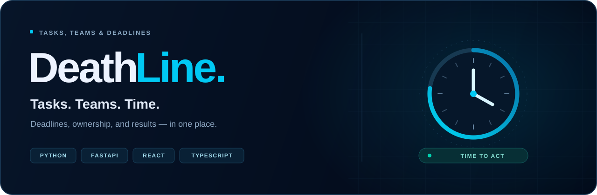

<p align="center">
  <strong>Дедлайны под контролем.</strong><br>
  Сервис для команд, в котором у каждой задачи есть исполнитель, срок и результат.
</p>

<p align="center">
  <a href="#возможности">Возможности</a> ·
  <a href="#состояние-проекта">Статус</a> ·
  <a href="#локальный-запуск">Запуск</a> ·
  <a href="#api">API</a> ·
  <a href="#планы">Планы</a>
</p>

---

## Знакомьтесь, DeathLine


DeathLine объединяет задачи, участников команды и дедлайны. Администратор распределяет работу и следит за сроками. Сотрудник видит свои задачи, ближайший дедлайн и отмечает результат.

У проекта свой характер: тёмный интерфейс, голубые акценты, живые таймеры и отключаемые глитчи. За оформлением — конкретная идея: **видеть, что нужно сделать, кто за это отвечает и сколько времени осталось**.

## Возможности

| Для администратора | Для сотрудника |
| :--- | :--- |
| Создание команды и приглашение участников | Вступление в команду по ссылке |
| Назначение задач, приоритетов и дедлайнов | Список своих задач и ближайший срок |
| Изменение задач и перенос сроков | Завершение назначенных задач |
| Просмотр задач и участников команды | Доступ к своим задачам в рамках команды |

**Аккаунты:** регистрация, вход, выход, подтверждение почты и восстановление пароля через письмо. При успешном сбросе пароля старые сессии завершаются, ссылка становится недействительной.

**Команды:** права администратора и сотрудника определяются членством. Один аккаунт может состоять в нескольких командах с разными ролями. Приглашение привязано к почте и может быть принято или отменено.

**Задачи:** отдельные записи с исполнителем, приоритетом, дедлайном и датами создания, изменения и завершения. Истечение срока не завершает задачу автоматически.

## Состояние проекта

**Проект в разработке.** Интерфейс подготовлен, основные сценарии API реализованы. Подключение интерфейса к серверу — следующий отдельный этап: сейчас фронтенд открывается с пустыми данными и не выполняет серверные операции.

| Часть | Состояние |
| :--- | :--- |
| Кабинеты администратора и сотрудника, задачи, приглашения | Интерфейс подготовлен |
| Регистрация, сессии и подтверждение почты | Реализованы в API |
| Отправка писем и восстановление пароля | Реализованы в API, проверены с реальными письмами |
| Команды, членства и приглашения | Реализованы в API |
| Создание, чтение, изменение и выполнение задач | Реализованы в API |
| Редактирование профиля, личные заметки, GOAT | Следующие блоки бэкенда |
| Интеграция фронтенда и API | В плане |

## Стек

| Слой | Технологии |
| :--- | :--- |
| Интерфейс | React 18 · TypeScript · Vite · CSS |
| API | Python 3.14 · FastAPI · Pydantic 2 |
| Данные | PostgreSQL · SQLAlchemy · psycopg |
| Авторизация | Серверные сессии · HttpOnly cookie · pwdlib / Argon2 |
| Почта | SMTP через TLS · Gmail · одноразовые ссылки |

## Локальный запуск

Понадобятся **Python 3.14**, **Node.js 22+ / npm** и **PostgreSQL**. Команды ниже предполагают запуск из корня репозитория, если не указано другое.

### Фронтенд

```bash
cd frontend
npm install
npm run dev
```

Откройте [http://127.0.0.1:5173](http://127.0.0.1:5173). Для сборки используйте `npm run build`; результат появится в `frontend/dist/`.

<details>
<summary><strong>Бэкенд: окружение, база данных и почта</strong></summary>

Создайте виртуальное окружение и установите зависимости. Пример для macOS / Linux:

```bash
python3.14 -m venv .venv
source .venv/bin/activate
python -m pip install fastapi 'uvicorn[standard]' sqlalchemy 'psycopg[binary]' \
  'pwdlib[argon2]' 'pydantic[email]' pydantic-extra-types phonenumbers python-dotenv
```

В текущей версии проекта файл зависимостей ещё не оформлен; команда выше перечисляет пакеты, которые используются бэкендом.

Создайте базу PostgreSQL и укажите собственные параметры подключения в [`backend/DataBase/database.py`](backend/DataBase/database.py). Сейчас подключение задаётся в этом файле.

Создайте `backend/.env` с настройками почты. Значения пользователя и пароля в примере необходимо заменить:

```dotenv
SMTP_HOST=smtp.gmail.com
SMTP_PORT=465
SMTP_USER=your-project@gmail.com
SMTP_PASSWORD=your-app-password
SMTP_FROM_NAME=DeathLine
FRONTEND_URL=http://127.0.0.1:5173
```

Для Gmail используется пароль приложения. `.env` остаётся локальным и не добавляется в Git. `FRONTEND_URL` определяет адрес ссылок в письмах.

Для Python с python.org на macOS завершите установку сертификатов через `/Applications/Python 3.14/Install Certificates.command`, если этот шаг ещё не выполнен. Подробности — в [документации Python](https://docs.python.org/3.14/using/mac.html#installation-steps).

В активированном окружении перейдите в `backend` и создайте недостающие таблицы:

```bash
cd backend
python - <<'PY'
from DataBase.database import Base, engine
from DataBase import models

Base.metadata.create_all(bind=engine)
PY
```

`create_all` создаёт отсутствующие таблицы; существующие записи сохраняются. Изменение структуры уже созданных таблиц требует отдельной миграции.

Запустите API **из папки `backend`**:

```bash
python -m uvicorn main:app --reload
```

Документация доступна по адресу [http://127.0.0.1:8000/docs](http://127.0.0.1:8000/docs), OpenAPI — [http://127.0.0.1:8000/openapi.json](http://127.0.0.1:8000/openapi.json).

Страницы фронтенда `/verify-email` и `/reset-password` ещё предстоит подключить. Пока токен из письма можно передать в соответствующий запрос через Swagger.

</details>

## API

Основные маршруты текущей реализации:

| Метод | Маршрут | Назначение |
| :--- | :--- | :--- |
| `POST` | `/auth/register` | Создать аккаунт и попытаться отправить письмо подтверждения |
| `POST` | `/auth/login` | Войти и получить cookie сессии |
| `GET` | `/auth/me` | Получить текущего пользователя |
| `POST` | `/auth/logout` | Завершить сессию |
| `POST` | `/auth/verify-email` | Подтвердить почту токеном из письма |
| `POST` | `/auth/resend-verification` | Запросить новое письмо подтверждения |
| `POST` | `/auth/forgot-password` | Запросить ссылку для восстановления пароля |
| `POST` | `/auth/reset-password` | Установить новый пароль по токену |
| `POST`, `GET` | `/teams` | Создать команду или получить свои команды |
| `GET` | `/teams/{team_id}/members` | Получить участников команды |
| `POST`, `GET` | `/teams/{team_id}/tasks` | Создать задачу или получить задачи команды |
| `GET`, `PATCH` | `/teams/{team_id}/tasks/{task_id}` | Получить или изменить задачу |
| `POST` | `/teams/{team_id}/tasks/{task_id}/complete` | Завершить свою задачу |
| `GET` | `/teams/{team_id}/my-tasks` | Получить свои задачи в команде |
| `POST`, `GET` | `/teams/{team_id}/invitations` | Создать приглашение или получить список |
| `DELETE` | `/teams/{team_id}/invitations/{invitation_id}` | Отменить приглашение |
| `GET` | `/invitations/{token}` | Просмотреть приглашение |
| `POST` | `/invitations/{token}/accept` | Принять приглашение |

Доступ к командным операциям зависит от членства и роли. Актуальные схемы запросов, ответы и ограничения смотрите в Swagger запущенного API.

## Планы

- [ ] Редактирование своего профиля: имя, телефон, Telegram и часовой пояс.
- [ ] Анкеты сотрудников с контактами и местным временем.
- [ ] Личные заметки администратора: отдельные записи для каждого автора.
- [ ] GOAT: рейтинг команды, статистика и графики.
- [ ] Общая проверка сложности пароля для регистрации, восстановления и смены. Правила предстоит согласовать.
- [ ] Подключение интерфейса к API, включая страницы подтверждения почты и сброса пароля.
- [ ] Подготовка конфигурации и защиты API к публикации.

## Структура

```text
DeathLine/
├── backend/
│   ├── api/
│   │   ├── service/       # Логика аккаунтов, команд, задач, приглашений и писем
│   │   ├── auth.py        # Авторизация и восстановление доступа
│   │   ├── teams.py       # Командные операции
│   │   ├── invitations.py # Принятие и просмотр приглашений
│   │   └── shemas.py      # Схемы запросов и ответов
│   ├── DataBase/          # Модели и подключение к PostgreSQL
│   ├── config.py         # Настройки из .env
│   └── main.py           # Приложение FastAPI
├── frontend/
│   ├── src/features/     # Вход, регистрация, кабинеты и задачи
│   ├── src/styles/       # Общие стили
│   └── public/brand/     # Логотип и иллюстрации
└── docs/assets/          # Оформление README
```

Подробнее: [фронтенд](frontend/README.md) · [план бэкенда](frontend/docs/BACKEND_NEXT_STEPS.md) · [проектный контракт API](frontend/docs/API_CONTRACT.md).

План и проектный контракт содержат предложения для дальнейшей интеграции и могут отличаться от уже реализованных маршрутов. Текущее поведение описывает OpenAPI работающего сервера.
